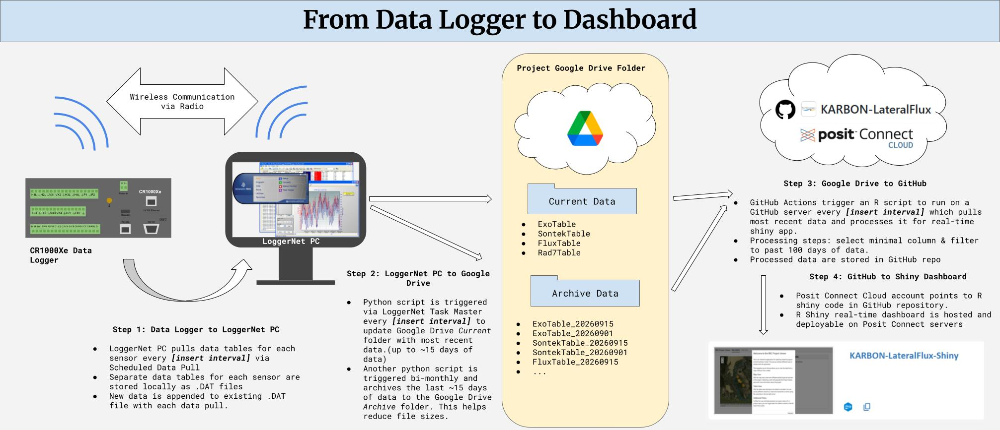

# KARBON-LateralFlux

## Repo Description

This repo hosts the code and data used to generate a near real-time monitoring dashboard for the KARBON Lateral Flux project.

GitHub Actions are deployed in this repo to automate data pulling from a Google Drive folder and processing for R Shiny deployment. Other scripts (like the data logger's CRBasic progrom) are stored and managed in this repo, but not called from the GitHub Action.

## Software Required

In order for this data pipeline to run, we need the following software:

- *Campbell Scientific LoggerNet Admin* - Handles data logger configuration and programming, scheduled data collection, and automated tasks from the LoggerNet server.

- *Python (v3.14)* - Used to process to copy local data from LoggerNet server to shared Google Drive.

- *R (v4.6.1)* - Used to copy Google Drive data to GitHub repo, process data, and generate Shiny application.

- *Google Drive & Google Drive API* - Data storage and access.

- *Posit Connect Cloud* - R Shiny deployment.

## Folder Structure

- *Data* - Holds raw and processed data.

  - *Raw -* Exact data copies from Google Drive

  - *Processed* - Data processed for real-time application

- *Scripts -* Contains code / software

  - *CRBasic -* Data Logger program for data collection and data table creation.

  - *Python -* Programs for data backup to Google Drive.

  - *R* - Programs for data access to Google Drive, data processing, and R Shiny application.

- *Images* - Images for reference in GitHub repo.
